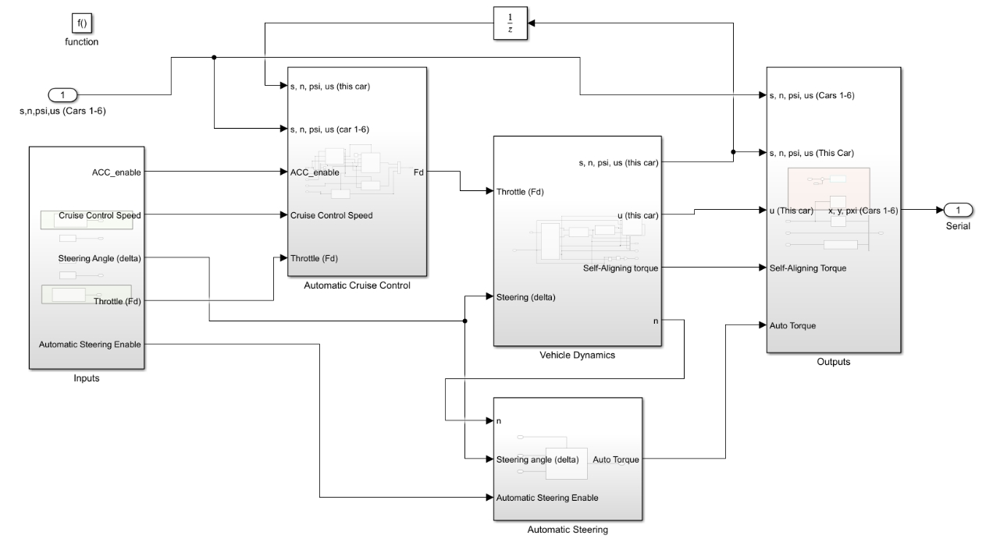
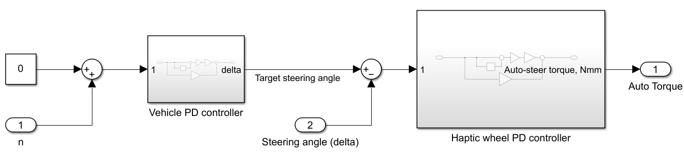

This is the final project for **EECS 461 Embedded Control Systems** at UM. The course is all about the path from a control law on paper to code running on a real microcontroller: model the plant in Simulink, design the controller, auto-generate C code, and flash it onto an NXP S32K144 board. For the final project, everything we built during the semester came together into one thing: **a car you drive with a haptic steering wheel**, racing on a shared virtual track against other lab stations.

The "steering wheel" is a small torque-controlled motor with an encoder. You turn it to steer, and the motor pushes back with the forces a real car would give you, such as the self-aligning torque that pulls the wheel back to center. The car itself only exists in simulation. The vehicle dynamics run in real time on the board, and the result is streamed over serial to an Unreal Engine scene so you can see the car drive on the road.

On top of manual driving, the car has two "driver assistance" features:
- **Adaptive Cruise Control (ACC):** holds a set speed, and automatically slows down and keeps a safe following distance when another car is in front.
- **Automatic Steering:** keeps the car at the center of the road by applying torque on the haptic wheel. Let go of the wheel, and it steers by itself.

# System Architecture
The whole system is one Simulink model, shown below. The **Inputs** block reads the hardware: the encoder on the wheel gives the steering angle, a potentiometer acts as the throttle, and DIP switches turn ACC and auto-steering on and off. The **Vehicle Dynamics** block turns throttle force and steering angle into the car's motion, written in road coordinates (distance along the road *s*, lateral offset *n*, heading *ψ*). The positions of the other cars arrive over the **CAN bus**, and the **Outputs** block sends our car's state back out over serial and drives the motor torque on the wheel.

*Top-level Simulink model, which is auto-coded and runs on the S32K144.*

The teaser video at the top is a re-rendered closed-loop simulation of this model on the course track, using our controller parameters. It shows the car steering back to the lane center, switching from cruise to follow mode behind a slower car, then speeding back up once the road is clear.

# Adaptive Cruise Control
ACC first needs to know *who* to follow. Since every station broadcasts its car's position over CAN, we wrote a small **Pick Lead** S-function in C: it loops over the other six cars, keeps the one that is ahead of us (*si* > *s0*) and closest, and outputs its distance and speed. If nobody is ahead, it simply returns our own state, so the follow controller has nothing to react to.

The controller then has two modes:
- **Velocity control:** a PI controller on the speed error, driving the car toward the cruise speed set by the driver.
- **Position control:** a PD controller on the gap to the lead car, keeping a fixed following distance.

The switching logic picks position control as soon as the lead car gets too close, and hands control back to velocity control once the road ahead is clear. The output is just a throttle force *Fd* that goes into the vehicle model, the same as the driver's pedal.

# Automatic Steering
Auto-steering is a **cascaded PD controller**. The outer loop looks at the lateral offset *n* from the road center and computes a target steering angle. The inner loop compares that target with the actual angle of the haptic wheel and computes the motor torque needed to turn the wheel there. In other words, the controller doesn't steer the car directly: it **turns the physical wheel**, and the wheel steers the car. That's also why you can feel it working (and fight it) with your hand.

*Cascaded PD controller: vehicle loop (outer) and haptic wheel loop (inner).*

For tuning, we wrote out the closed-loop transfer function of each loop, which is second order, and matched its characteristic equation with the standard form *s² + 2ζωns + ωn²*. This turns gain tuning into choosing a response speed and a damping. We chose ωn = 10 rad/s, ζ = 0.7 for the vehicle loop, and a faster ωn = 30 rad/s, ζ = 0.7 for the wheel loop, so that the inner loop settles well before the outer loop needs it. The wheel model (inertia, damping, stiffness) came from a system identification we did on the haptic wheel earlier in the semester.

# Some Thoughts
The most satisfying part of this project is that every block in the diagram above is something we built in an earlier lab: the encoder reading, PWM, the virtual spring and damper on the wheel, CAN communication, S-functions, and the vehicle model. The final project was mostly about putting them together. Then you plug the board in, and the wheel actually fights back when you take a curve too fast.

Of course, putting them together didn't go perfectly. Our first version of the vehicle dynamics was a hand-written S-function, and it kept failing with an error that didn't tell us much. It turned out we had mixed up discrete and continuous states in the wrapper. In the end, we rebuilt that part with plain gain blocks and discrete integrators, which was less fancy but much easier to debug. Lesson learned: in model-based design, the simplest block diagram that works is usually the best one.
